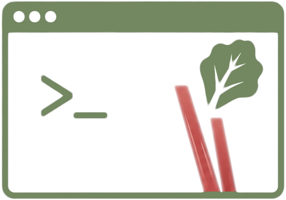
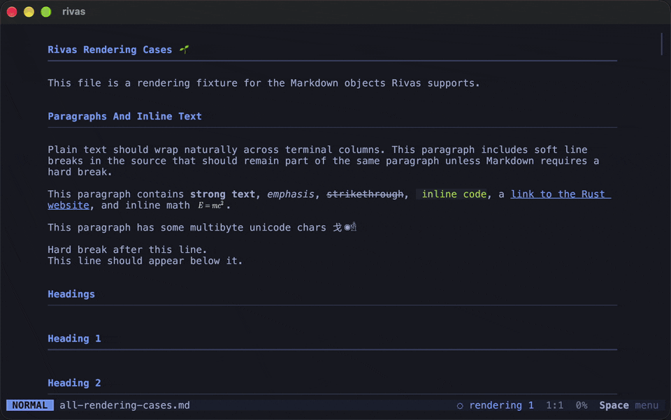
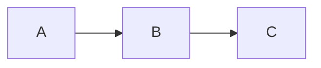

# Rivas

Rivas is a terminal Markdown viewer focused on rendering rich Markdown content
directly in Kitty-compatible terminals. It parses Markdown, renders terminal
text with iocraft, and displays image-backed content through the Kitty graphics
protocol.

## Features

- Headings, paragraphs, block quotes, thematic breaks, and wrapped text.
- Inline emphasis, strong text, strikethrough, inline code, links, and inline math.
- Ordered, unordered, nested, and task lists.
- Footnotes with numeric or named labels.
- Tables with Markdown alignment markers.
- Six built-in color themes, switchable at runtime with `Ctrl+T`.
- Folder browsing: open entire folders (`rivas .` or `rivas folder/`) with an integrated sidebar file tree (`\`).
- Browser preview server with live reload: browse and view rendered Markdown in your web browser with KaTeX math, Mermaid diagrams, and instant hot-reload on save (`rivas serve` or `:serve`).
- Local raster images (Kitty graphics or text fallback).
- Mermaid diagrams rendered to PNG (Kitty graphics or text fallback).
- LaTeX-style math with two rendering modes:
  - **Unicode** (default): renders formulas as Unicode glyphs, works in any terminal.
  - **Image**: rasterizes via the Kitty graphics protocol for pixel-perfect layout.
- Vim-style source editing with a side-by-side live preview.
- Vim-style keyboard navigation in the rendered viewer.



## Requirements

Rivas works best with a Kitty-compatible terminal for image and diagram
rendering. Supported terminals:

- Kitty
- WezTerm
- Ghostty

On other terminals, Rivas runs with text fallbacks: images show as
`[Image: alt]`, mermaid diagrams show as `[Mermaid diagram]` with source code,
and math uses Unicode glyphs.

## 🚀 Installation and Usage

### 🪟 Windows

1. Download the `rivas-x86_64-pc-windows-msvc.zip` from the Assets in releases.
2. Extract the `.exe` file to a folder of your choice.
3. (Optional) Add the folder to your **System PATH** to run `rivas` from any terminal.

Note: Only works with nightly WezTerm on windows (since other versions do not have full kitty support).

### 🍎 macOS

**Via Binary:**

1. Download `rivas-x86_64-apple-darwin.tar.gz` from assets in releases.
2. Extract the file: `rivas-x86_64-apple-darwin.tar.gz`.
3. Move it to your bin folder: `sudo mv rivas /usr/local/bin/`.
4. **Note:** If macOS blocks the app, go to *System Settings > Privacy & Security* and click "Allow Anyway."

### 🐧 Linux

```bash
# Download the binary
curl -LO https://github.com/hessikaveh/rivas/releases/download/v0.4.2/rivas-x86_64-unknown-linux-gnu.tar.gz

# Extract and install
tar -xzf rivas-x86_64-unknown-linux-gnu.tar.gz
sudo install -m 755 rivas /usr/local/bin/rivas
```

Then simply run:

```sh
rivas examples/all-rendering-cases.md
```

## Editing

Rivas edits in place with Neovim-style modes and keys. Move the cursor onto
any block and it switches to its syntax-highlighted Markdown source, right
where the rendered block was; a colored marker in the left margin shows the
block you are on and your mode (blue Normal, green Insert, purple Visual).
Press `i` to type, `Esc` to return to Normal mode, and `:w` to save.

### The Space menu

Press `Space` in Normal mode to open a menu of everything you can do next,
in the style of LazyVim's which-key. Keys either run an action or open a
group; `Backspace` goes back a level and `Esc` closes the menu.

| Keys | Action |
|---|---|
| `Space Space` | Find file |
| `Space e` | Explorer: show, focus or hide |
| `Space /` | Search the document |
| `Space w` | Save |
| `Space f …` | File: `f` find, `e` explorer, `w` save, `b` open in browser |
| `Space u …` | UI: `t` next theme, `m` math mode, `+` / `-` graphics size |
| `Space q …` | Quit: `q` quit, `w` save and quit, `!` quit without saving |
| `Space ?` | Full keyboard reference (also `F1` or `:help`) |

### Explorer

`\` or `Space e` opens the file explorer and moves the keyboard into it.
The explorer and the document are separate panes, like editor windows: only
the focused one receives keys, and the status line shows `EXPLORER` while the
explorer has focus.

- `Ctrl-h` / `Ctrl-l` move focus to the explorer / document; `Tab` switches.
- In the explorer: `j`/`k` move, `l` or `Enter` opens (focus returns to the
  document), `h` collapses or jumps to the parent, `/` filters the whole
  workspace, `Esc` goes back to the document, `q` closes the explorer.
- Pressing `\` again from the document refocuses the explorer; from the
  explorer it hides it.

## CLI Options

```sh
rivas [OPTIONS] [PATH]
rivas serve [OPTIONS] [PATH]
```

| Option | Description |
|---|---|
| `--serve` | Start browser server with live reload and rich web rendering. |
| `--port <PORT>` | Port for the browser server (default: 3000). |
| `--no-open` | Do not automatically open the browser when serving. |
| `--math <MODE>` | Math rendering mode: `unicode` (default) or `image`. Unicode works everywhere; image requires Kitty graphics. |
| `--force-kitty` | Force Kitty graphics protocol even if the terminal is not auto-detected. Use if your terminal supports Kitty but isn't recognized. |
| `-t, --theme <THEME>` | Color theme: `tokyo-night` (default), `dracula`, `nord`, `gruvbox-dark`, `catppuccin-mocha`, or `solarized-light`. Can also be switched at runtime with `Ctrl+T`. |
| `--cell-width <PX>` | Override the pixel width of a terminal cell. Graphics are shown at their natural size mapped onto this cell, so this grows/shrinks images, diagrams, and formulas. Use to correct a terminal whose `TIOCGWINSZ` pixel size is wrong (e.g., a secondary display). If only one axis is given, the other defaults to its standard value (16). |
| `--cell-height <PX>` | Override the pixel height of a terminal cell (see `--cell-width`). If only one axis is given, the other defaults to 8. |
| `--debug` | Enable debug logging and visual overlay annotations. |

### 📂 Opening Folders and File Tree

You can open entire folders directly without specifying a starting file:

```sh
rivas .
rivas docs/
rivas /path/to/notes
```

Running `rivas` with no arguments in a terminal will automatically open the current directory.

- Rivas opens with the sidebar file tree visible on the left.
- If a `README.md` or `index.md` exists in the folder, it is displayed immediately.
- Use `↑`/`↓` (or `j`/`k`) to navigate files, `Enter` to open or toggle folders, and `\` to toggle the sidebar at any time.
- Press `/` in the sidebar to search every file in the workspace by path, including inside collapsed folders.

### 🌐 Serving in the Browser

Leverage your web browser's native rendering capabilities (crisp typography, KaTeX LaTeX math, interactive Mermaid.js diagrams, syntax highlighted code, and live hot-reload on save):

**From the CLI:**
```sh
# Serve the current directory and open the browser:
rivas serve

# Or serve a specific folder or file:
rivas serve docs/
rivas docs/ --serve
rivas serve README.md --port 8080
```

**From inside the TUI editor:**
Press `:` in Normal mode and type `:serve` or `:browser`. Rivas will start the background server and open your current document in the browser immediately.

**Browser Features:**
- **Sidebar File Explorer**: Collapsible folder tree with instant filtering (`/` or `Ctrl/⌘+K`); `\` shows or hides it.
- **Live Reload (SSE)**: Automatically reloads whenever any Markdown file is edited and saved. Scroll position is preserved across reloads.
- **Rich Rendering**: KaTeX math ($...$ and $$...$$), Mermaid diagrams, GitHub-flavored tables, task lists, and relative image resolution.
- **Light & Dark**: Follows your system setting; toggle with `t` or the header button.
- **Editor with Live Preview**: Press `e` for a side-by-side editor whose preview updates as you type; save with `Ctrl/⌘+S`.
- **Reading Aids**: An "On this page" outline, linkable headings, copy buttons on code blocks, and GitHub alerts (`> [!NOTE]`).
- **Source & Copy**: View the Markdown source (`r`) or copy it (`c`). Press `?` for all shortcuts.

### Themes

Rivas ships with six built-in color themes:

| Theme | Style |
|---|---|
| `tokyo-night` | Dark (default) |
| `dracula` | Dark |
| `nord` | Dark |
| `gruvbox-dark` | Dark |
| `catppuccin-mocha` | Dark |
| `solarized-light` | Light |

Select one at startup:

```sh
rivas --theme dracula document.md
```

Or cycle through all themes at runtime with `Ctrl+T`; the new theme's name is
shown briefly in the status line. Syntax highlighting, math images, and Mermaid
diagrams all follow the active theme.

### Math Modes

**Unicode mode** (`--math unicode`, the default) converts LaTeX formulas to
Unicode glyphs. This works in any terminal and is fast.

**Image mode** (`--math image`) rasterizes formulas via the Kitty graphics
protocol for pixel-perfect rendering. Requires a Kitty-compatible terminal
(Kitty, WezTerm, or Ghostty). If the terminal is not recognized, Rivas
automatically falls back to Unicode mode with a warning.

You can also switch math modes at runtime by pressing `:` in Normal mode and
typing `math unicode`, `math image`, or just `math` to toggle.

### Force Kitty Graphics

If your terminal supports the Kitty graphics protocol but is not auto-detected,
use `--force-kitty` to enable it:

```sh
rivas --force-kitty --math image document.md
```

This overrides the terminal detection and attempts Kitty graphics for images,
diagrams, and image-mode math. If the terminal doesn't actually support the
protocol, images and diagrams will simply not render.

### Adjusting Graphic Sizes

Images and diagrams render at their **natural size** (their own pixels mapped
onto the terminal cell), shrinking if they would overflow the screen. If the
automatic cell-size detection is wrong for your display, you can resize
graphics two ways:

- **At runtime** — in Normal/Visual mode press `[` to shrink or `]` to enlarge
  every image, diagram, and formula, and see the result immediately:

  ```
  :q Quit | C-p Find | j/k Scroll | gg/G Top/Bottom | :math Math mode | C-t Themes | 🔍 [ ]
  ```

- **From the CLI** — pin the cell size explicitly with `--cell-width` /
  `--cell-height` (see the table above). This also changes the rasterization
  resolution, so use it when you want sizing to be fixed ahead of time.

## Supported Markdown Notes

Math can be written inline with dollar delimiters:

```md
The quadratic formula is $x = \frac{-b \pm \sqrt{b^2 - 4ac}}{2a}$.
```

Display math can use `$$` blocks or fenced `math` blocks:

````md
$$
\int_0^\infty e^{-x} \, dx = 1
$$

```math
\Delta(Rivas) = \delta(rivas) \times \frac{2}{2}
```
````

Press `:math` in Normal mode to toggle between Unicode and Image rendering
at runtime, or use `:math unicode` / `:math image` to switch directly.

Mermaid diagrams use fenced `mermaid` blocks:

````md

````

Local images are resolved relative to the Markdown file:

```md

```

Footnotes work with numeric or named labels:

```md
Rivas supports footnotes[^1] and named ones[^note].

[^1]: A numeric footnote body.
[^note]: A named footnote body.
```

Numeric references render as superscript markers; definitions render inline at
their source position with their label.

## Development

Run the test suite:

```sh
cargo test
```

The math tests compile LaTeX-like input through TyLax and Typst, rasterize the
resulting SVG to PNG, and verify that rendered output is not an all-white page.
